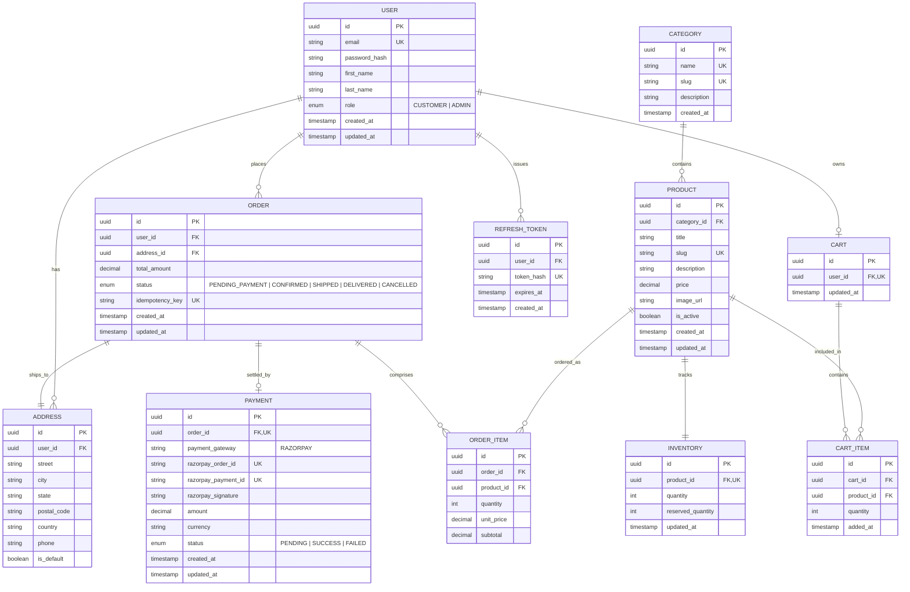

# ShopSphere Database Schema & ERD

## 1. Entity Relationship Diagram (ERD)

---

## 2. Table Specifications & Indexes

### `users`
- Primary Key: `id` (UUID)
- Unique Index: `email`
- Fields: `first_name`, `last_name`, `password_hash`, `role` (`CUSTOMER`, `ADMIN`), timestamps

### `products`
- Primary Key: `id` (UUID)
- Foreign Key: `category_id` references `categories(id)` ON DELETE RESTRICT
- Indexes: `category_id`, `price`, `title` (Full Text Search index on `title`, `description`)

### `inventories`
- Primary Key: `id` (UUID)
- Foreign Key: `product_id` references `products(id)` ON DELETE CASCADE
- Constraint: `quantity >= 0`, `reserved_quantity >= 0`, `quantity >= reserved_quantity`

### `orders`
- Primary Key: `id` (UUID)
- Foreign Keys: `user_id`, `address_id`
- Unique Index: `idempotency_key` (Prevents duplicate order submissions)
- Indexes: `user_id`, `status`, `created_at`

### `payments`
- Primary Key: `id` (UUID)
- Foreign Key: `order_id` references `orders(id)`
- Unique Indexes: `razorpay_order_id`, `razorpay_payment_id`
