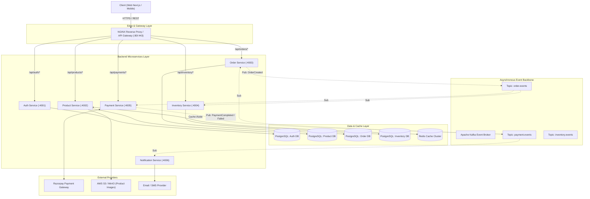
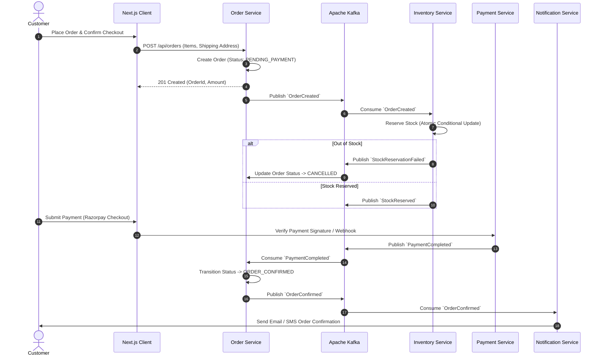

# ShopSphere System Architecture

## 1. System Overview

ShopSphere uses an **Evolutionary Architectural Approach**:
1. **Initial State (Phases 1-9)**: Modular Monolith where domain boundaries (Auth, Product, Cart, Order, Inventory, Payment) are strictly encapsulated inside modular services/folders within a single Express + Prisma + PostgreSQL codebase.
2. **Intermediate Transition (Phase 10-12)**: Extraction into independent microservices with dedicated databases, an NGINX API Gateway, and asynchronous Kafka event streaming.
3. **Cloud Native Target (Phase 13-18)**: Containerized deployment on Kubernetes with Prometheus/Grafana observability.

---

## 2. High-Level Architecture Diagram

---

## 3. Asynchronous Order Execution Flow (Saga Pattern)

---

## 4. Key Architectural Guarantees & Patterns

1. **Idempotency**: All payment webhooks and Kafka consumers use idempotency keys stored in Redis/PostgreSQL to prevent duplicate deductions or duplicate order processing.
2. **Concurrency Control in Inventory**: PostgreSQL row-level locking (`SELECT ... FOR UPDATE`) or atomic conditional updates (`UPDATE inventory SET stock = stock - qty WHERE product_id = ? AND stock >= qty`) to prevent overselling.
3. **Cache-Aside Pattern**: Read product/category data from Redis first; on cache miss, query PostgreSQL, set with TTL (Time-To-Live), and return. Cache is invalidated on product update/delete.
4. **Security by Design**:
   - Access tokens (Short-lived, 15m) in memory / headers.
   - Refresh tokens (Long-lived, 7d) stored securely in `HttpOnly`, `SameSite=Strict` cookies.
   - Role-Based Access Control (`CUSTOMER`, `ADMIN`).
   - Rate limiting via Redis on critical endpoints (login, checkout).
